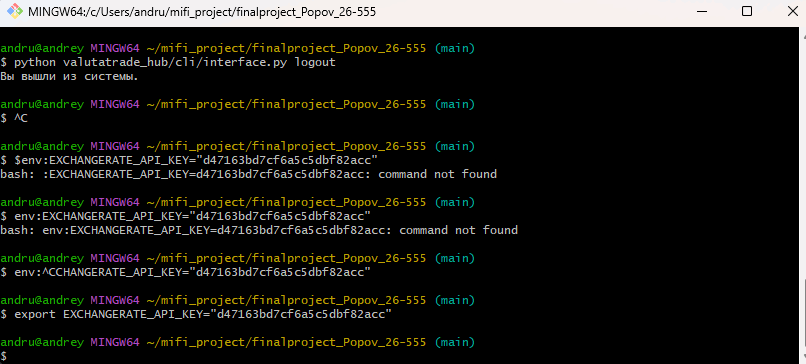

# ValutaTrade Hub

Платформа для отслеживания курсов валют, управления пользовательским портфелем и симуляции торговых операций (покупка/продажа) с поддержкой автоматического парсинга данных из внешних API.

## 📂 Структура проекта

Проект организован в виде модульной структуры:
- `valutatrade_hub/core/` — доменная логика, модели (`User`, `Wallet`, `Portfolio`), usecases и кастомные исключения.
- `valutatrade_hub/parser_service/` — сервис парсинга: интеграция с CoinGecko и ExchangeRate-API, хранилище (`storage.py`), обновление (`updater.py`) и фоновый планировщик (`scheduler.py`).
- `valutatrade_hub/cli/` — интерфейс командной строки (`interface.py`) для взаимодействия с пользователем.
- `valutatrade_hub/infra/` — конфигурационные файлы и управление окружением.
- `data/` — локальное хранилище данных в формате JSON (`users.json`, `portfolios.json`, `rates.json`, `exchange_rates.json`).
- `logs/` — файлы ротации логов действий.

## 🛠 Установка и запуск

1. Установите менеджер зависимостей **uv**.
2. Клонируйте репозиторий и перейдите в корень проекта.
3. Установите зависимости проекта:
   ```powershell
   uv sync
   ```

## 🔑 Конфигурация окружения

Для работы парсера фиатных валют требуется ключ доступа от ExchangeRate-API. Задайте его в переменной окружения перед запуском команд:

```powershell
$env:EXCHANGERATE_API_KEY="ваш_реальный_ключ_api"
```



## 🚀 Примеры команд CLI

Управление пользователями:
```powershell
python valutatrade_hub/cli/interface.py register --username investor --password secure_password123
python valutatrade_hub/cli/interface.py login --username investor --password secure_password123
```

Торговля и портфель:
```powershell
python valutatrade_hub/cli/interface.py buy --currency BTC --amount 0.05
python valutatrade_hub/cli/interface.py sell --currency BTC --amount 0.01
python valutatrade_hub/cli/interface.py show-portfolio --base EUR
python valutatrade_hub/cli/interface.py get-rate --from USD --to RUB
```

Управление сервисом парсинга:
```powershell
python valutatrade_hub/cli/interface.py update-rates
python valutatrade_hub/cli/interface.py update-rates --source coingecko
python valutatrade_hub/cli/interface.py show-rates --top 3
python valutatrade_hub/cli/interface.py scheduler --interval 3600
```

## 🔄 Работа с кэшем и TTL

Все загруженные котировки сохраняются в локальный кэш `data/rates.json` с фиксацией времени актуальности (`updated_at`). Если данные устаревают (превышен TTL), система уведомит о необходимости запустить команду `update-rates`. Вся история изменений курсов дополнительно фиксируется в `data/exchange_rates.json`.